# XdStorage — Performance Study & Configuration Recommendations (YAML format)

Recorded: 2026-10-19 (**post-fix re-run** — re-measured after the B+Tree re-open fix R-53, commit `cf36f7f`; re-open sanity `SweepReopenRepro` = 0/0/0 before this run) · Branch `xdstorage-2.0` · Runner: OpenJDK **21.0.7**, Ubuntu Linux, 24 cores / 62 GB, quiet load (loadavg < 0.5)
Harness: `org.flib.xdstorage.performance.sweep.XdStorageConfigSweep` (test sources), raw results in [`docs/perf/`](perf/)

**Study scope:** how the two storage-engine structural knobs — the **B+Tree fill factor `t`** and the
**fragment size** (objects per fragment file) — plus the id-index type (**Hash vs B+Tree**) and the
**search-index `t`** affect the real end-to-end lifecycle of data through the public facade
(`save / load / update / delete / search`, batched transactions, cold restart). Everything runs in the
**YAML** on-disk format at **N=5000** entities (N=2500 for the heavier search graph).

> This is the **second edition**, re-measured on the engine with the R-53 re-open fix. The first
> edition (same day, pre-fix) had to exclude all re-open/cold measurements: B+Tree-backed structures
> were unreadable after restart. Cold-path behavior — previously missing — is now a first-class part
> of every section, and it changes the id-index recommendation from "Hash because BTree is broken"
> to a real workload trade-off.

---

## 0. TL;DR — recommendations

| Question | Recommendation |
|---|---|
| **Id index type** | **Both are restart-safe now (R-53) — choose by workload:** **Hash** (default) for the best cold-read-after-restart (52 µs/op vs 87), the fewest files (12 vs 101), and the simplest ops story; **B+Tree t=64** for insert-heavy and long-running warm workloads (bulk insert 49.6k vs 23.6k ops/s, read-with-tx 591 vs 40 ops/s). See [§7.1](#71-id-index-choice-hash-vs-btree-same-entity-frag512-n5000). |
| **B+Tree fill factor `t` (id index)** | **t = 32…128, measured optimum t = 64** (bulk insert 49.6k ops/s, 3.7 ms commits, cold find 87 µs/op, delete-all 183 ms). **Never below 8.** The annotation default **t = 500 is ~12× slower on inserts** at N=5000 and pays a 14 ms cold first find. |
| **Fragment size** | **128–512 objects per fragment** (≈ 55–225 KB per fragment file for ~430 B entities). Measured optimum **128**. Avoid fragment files > ~1 MB (whole-file-rewrite write amplification) and < ~10 KB (per-file overhead, cold-scan penalty). |
| **Search index `t`** | **t = 64** — best indexed-insert (8.9k ops/s), best cold search (134 µs/op vs 163 at t=8); the t=500 default is **5× slower on indexed inserts** and pays 34 ms on the first cold query. Query latency is otherwise t-insensitive; keep primary criteria `EQUALS`. |
| **Storage config** | Defaults are sound for OLTP-ish embedding: `durableWrites=false` for throughput, **turn it on when power-loss durability matters**; `journalWrites` (W-1) is the candidate fix for the commit-bound write path; `workerPoolSize=15` fits a 24-core box; tx timeout 3 s default is tight for bulk batches — pass explicit timeouts (harness uses 120 s for 500-object batches). |
| ~~**P0 blocker**~~ **RESOLVED (R-53)** | B+Tree-backed structures were unreadable after storage re-open (Hash id index unaffected). Fixed in `cf36f7f`, regression-covered by `XdStorageW2ReopenBTreeTest`; history and verification in [§6](#6-btree-re-open-blocker-resolved-and-verified-r-53). |

---

## 1. Executive summary

* **Write path is commit-bound, not index-bound.** A batched 500-object commit costs 3–17 ms depending
  on configuration; the index maintenance inside it is a minor term once `t` and fragment size are in
  the recommended range. The dominant structural cost is **how many bytes a commit must rewrite**
  (fragment size) and **how many node files a mutation must write** (B+Tree `t`).
* **B+Tree `t` trades node-file count against node-file size — and cold-read latency.** At N=5000,
  t=2 produced **9 981 tree files (19.6 MB of index for 1.6 MB of data)**, 129 ms commits, a 3.46 s
  delete-all, and **387 µs cold point-lookups**; t=64 produced 83 files (1.5 MB), 3.7 ms commits,
  183 ms deletes, and 87 µs cold lookups. Warm point-lookups stay ~12–16 µs/op for every `t` — the
  structural penalty is paid on writes, file counts, deletes, and cold starts.
* **Cold reads after restart are the price of tree depth: ~35 µs per tree level.** Cold point-lookup
  = one YAML parse per tree level on the descent: t=2 (depth ~12) → 387 µs/op, t=8 → 139 µs, and from
  t=32 the batch amortizes to an **80–87 µs plateau**. A hash-index cold read needs one fragment load
  → ~52 µs/op.
* **Fragment size is a write-amplification dial.** 626 files (frag=8) raise cold-scan time from 58 to
  110 ms and cost ~30% insert throughput; one file for the whole class (frag=8192, 4.5 MB) makes
  *every* commit rewrite those 4.5 MB — the update pass grows +85%, and per-op transactional reads
  degrade to 20 ops/s (commit machinery iterating the cache; zero file writes — see
  [§5.3](#53-additional-finding-read-only-transaction-cost-scales-with-resource-size)).
* **Read-only transaction overhead scales with index/resource size on the Hash path**
  (25 ms/op at N=5000 vs 2.8 ms/op for the BTree path — measured with **zero** file write-outs; the
  cost is in the commit protocol, not IO). This is the top optimization candidate for read-heavy
  workloads.
* **Search indexes are effectively free on top of an id load** (EQUALS ~20–26 µs/op warm; child
  criteria are evaluated on the already-fetched index record — +0% cost within noise), but are
  **O(dataset) full scans** for non-EQUALS primary criteria (~53 ms per scan at N=2500).
* **Zero engine anomalies** across all serial runs: no lock-acquisition timeouts, no
  `findRetryBudgetExhaustions`, no lock waits > 1 s (`XdStorageMetrics.engineEvents()` empty) — the
  documented contention families belong to concurrent workloads, not to serial lifecycle phases.

---

## 2. Methodology

* **Harness:** `XdStorageConfigSweep` (`src/main/test/.../performance/sweep/`), plain-Java serial
  phases (not JMH) because the swept knobs are compile-time annotation values and per-config storage
  directories are required. JMH micro-benchmarks (`docs/BENCHMARKS.md`) remain the tool for
  concurrent facade throughput; this study isolates **structure → cost**.
* **Phases per configuration** (single JVM, sequential): open → bulk insert (10 batched commits of
  500, per-commit timings) → warm batched finds (5 reps × 3000 random ids, median) → finds with
  per-op transaction (1000 ops) → update-all → **shutdown → re-open → cold scan (Hash suite) →
  cold first find → cold find batch → delete-all (real, post-re-open)** → file statistics.
* **Metrics per phase:** `storage.getMetrics()` deltas (`resourceWriteOuts`, `resourceWriteOutNanos`,
  tx counters, derived avg µs per write-out), JVM-wide `engineEvents()`, on-disk file count/bytes by
  class, heap-after-warm-read probe.
* **Fairness:** identical entity shape across id-index types (`SweepHashEntity` vs `SweepBTreeT*Entity`
  differ only in `@XdStorageObjectIdIndexType`); fixed seed (42) for key shuffling; per-config fresh
  storage directory and unique storage name (provider registry contract); engine JIT warm-up via a
  throwaway find rep before the measured reps of every config.
* **Threats to validity:** single machine, single JVM for the whole sweep (JIT state carries across
  configs — mitigated by per-config warm-up and the fact that costs are dominated by IO + commit
  machinery, not micro-architectural effects); serial single-threaded phases by design (the known
  concurrency flakes — "рассинхрон структуры", retry-budget storms — are stress-test territory and
  would pollute the structural signal); absolute numbers are ballpark for this class of hardware,
  **relative gaps are the signal**; N=5000 is a small-DB regime — re-measure before extrapolating to
  millions of objects (the file-count and depth laws keep their shape, the crossings may shift);
  warm BTree numbers moved up to ~30% vs the pre-fix run (insert at t=64: 37.6k → 49.6k ops/s) —
  the R-53 fix touched the node materialization path, plus normal variance; **this document's
  numbers are the authoritative set**.
* **Reproducibility:** raw JSON/CSV/console log archived in `docs/perf/`; re-run via
  [§9](#9-how-to-rerun).

---

## 3. The knobs being swept

| Knob | Where set | Semantics | Default |
|---|---|---|---|
| Id index type | `@XdStorageObjectIdIndexType(indexType=…)` | `Hash` — one `data/<Class>/index.yaml` with id→fragment records, in-memory map cache; `BTree` — persisted `XdStorageBTree`/`XdStorageBTreeNode` objects (**one file per node**) | `Hash` |
| B+Tree fill factor `t` | `@XdStorageObjectIdIndexType(t=…)` / `@XdStorageObjectSearchIndex(t=…)` | Node holds `t-1 … 2t-1` keys; tree depth ≈ log_t(N); **node = file** | `500` (both annotations) |
| Fragment size | `XdStorageProvider.newOrGetFileStorage(name, folder, fragmentSize, …)` | Objects per `data/<Class>/<Class>-<frag>.yaml` file for `StoreAsClassObjects` entities; **commit rewrites every touched fragment file** | user-supplied (no engine default; tests use 128–250, JMH 1024) |

---

## 4. Results: B+Tree fill factor `t` (id index)

N=5000, fragment=512, YAML, Hash→BTree variation only. Full data: [`docs/perf/tsweep.json`](perf/tsweep.json).

| t | tree+node files | tree bytes (KB) | insert ops/s | commit mean (ms) | warm find (µs/op) | **cold find (µs/op)** | **delete-all (s)** | write-outs during insert | avg write-out (µs) |
|---:|---:|---:|---:|---:|---:|---:|---:|---:|---:|
| **2** | **9 981** | **19 630** | **2 216** | **128.9** | 15.9 | **387** | **3.46** | **10 273** | 119 |
| 4 | 2 220 | 5 529 | 12 583 | 25.4 | 13.1 | 226 | 0.75 | 2 384 | 102 |
| 8 | 818 | 2 881 | 24 903 | 11.2 | 12.0 | 139 | 0.36 | 958 | 110 |
| 16 | 357 | 2 008 | 37 822 | 7.0 | 12.3 | 109 | 0.26 | 469 | 137 |
| 32 | 170 | 1 642 | 37 823 | 6.1 | 12.2 | 86 | 0.23 | 339 | 159 |
| **64** | **83** | **1 471** | **49 575** | **3.7** | 12.4 | **87** | **0.18** | **138** | 233 |
| 128 | 43 | 1 407 | 34 562 | 3.4 | 13.4 | 80 | 0.19 | 98 | 297 |
| 500 (default) | 14 | 1 350 | 4 246 | 3.4 | 15.6 | 81 | 0.20 | 69 | 432 |

Re-open itself is lazy and cheap at every `t` (10–59 ms); the first cold find costs 2.6–5.7 ms at
t≤128 and **14.3 ms at t=500** (parsing the ~999-key root node file). Per-op-transaction reads are
overhead-bound and t-insensitive (~580–613 ops/s).

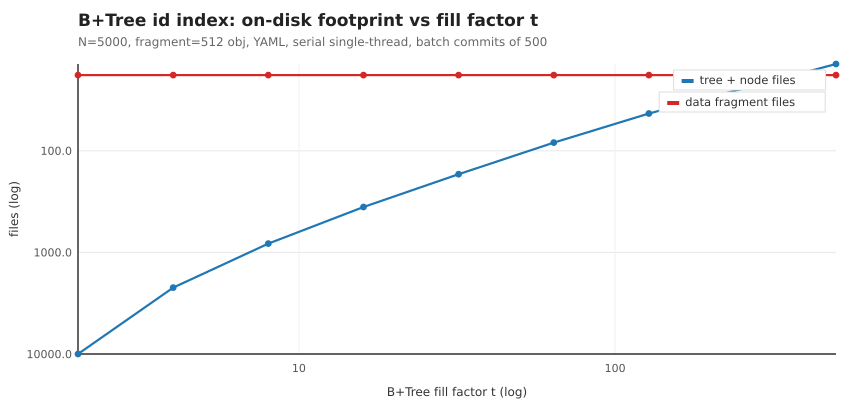
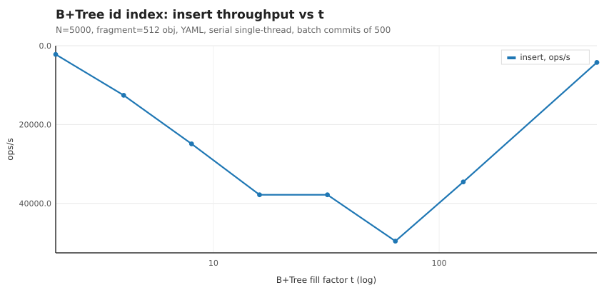
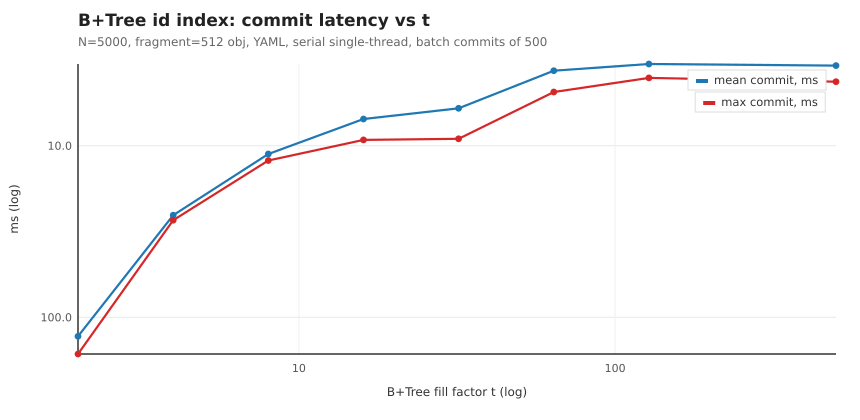
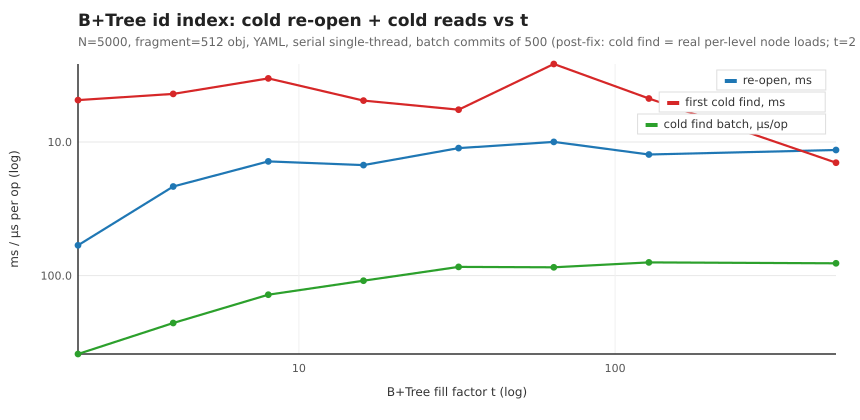
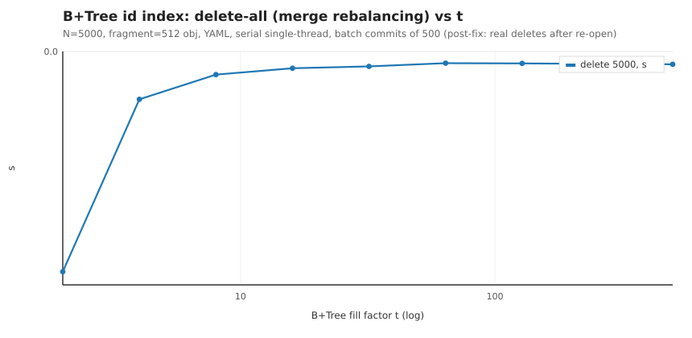
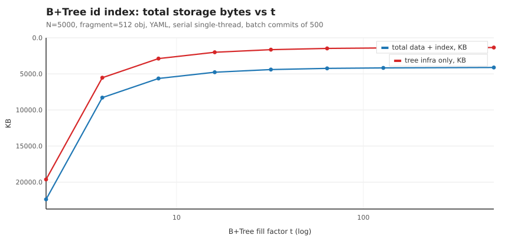

**Reading:**

1. **File count ≈ 2·N/t + internal nodes** — the engine stores **one file per B+Tree node**. t=2
   degenerates to ~2 files per key: 10k files, 19.6 MB of index for 1.6 MB of data (12× amplification),
   and every split rewrites O(depth) node files → 10 273 write-outs during a 5 000-object insert.
2. **Insert throughput peaks at t=64** (49.6k ops/s): deep enough that nodes are cheap to rewrite,
   shallow enough that splits are rare. t=500 collapses to 4.2k ops/s — every structural mutation
   serializes ~999-key nodes (avg write-out 432 µs), and the insert-time split cost dominates.
   The annotation default of **t=500 is the wrong default for this dataset size**.
3. **Warm find is t-insensitive** (12–16 µs/op): after warm-up the whole tree is an in-memory graph;
   bigger `t` costs a longer in-node key scan, smaller `t` costs more pointer hops — they cancel.
4. **Cold find after restart is the discriminator: ~35 µs per tree level.** t=2 (depth ~12) →
   387 µs/op, t=8 → 139 µs, and from t=32 the batch amortizes to an **80–87 µs plateau**. A service
   that restarts and serves sparse reads pays the depth tax on every uncached lookup — an independent
   reason (beyond the write path) to avoid small `t`.
5. **Real deletes cost ∝ depth too:** delete-all with merge rebalancing (post-re-open, i.e. with
   node loads) takes **3.46 s at t=2 vs 183–202 ms at t≥64** — a 19× gap that warm-path tables never
   show.
6. **Commit latency tracks t**: 129 ms mean at t=2 → 3.4–3.7 ms at t≥64. For latency-sensitive writers
   this is the single biggest lever.

**Recommendation (id-index BTree `t`):** **t = 32…128; t = 64 measured best on every axis**
(insert, commits, deletes, cold reads, reasonable file count). Never ship t < 8 (pathological on
every axis). Re-evaluate the `t()` defaults in both annotations
(`XdStorageObjectIdIndexType`, `XdStorageObjectSearchIndex`) — 500 optimizes file count at the price
of 12× insert throughput at N=5000; if a single default must serve all sizes, **64 is the safer
default**. For much larger N the optimum drifts up slowly (depth is log_t N) — re-run the sweep at
target volume before finalizing.

## 5. Results: fragment size (Hash id index)

N=5000 (~430 B/entity → ~4.5 MB of data), YAML. Full data: [`docs/perf/fragsweep.json`](perf/fragsweep.json).

| frag (obj/file) | data files | insert ops/s | commit mean (ms) | update-all (ms) | cold scan (ms) | warm scan (ms) | cold find (µs/op) | read w/ per-op tx (ops/s) | delete-all (ms) |
|---:|---:|---:|---:|---:|---:|---:|---:|---:|---:|
| 8 | 626 | 18 466 | 11.7 | 468 | **110** | 67.6 | 61 | 46.4 | 226 |
| 32 | 158 | 25 456 | 7.6 | 399 | 58.1 | 55.0 | 69 | 46.6 | 233 |
| **128** | **41** | **27 066** | **6.6** | **402** | 57.3 | 54.2 | 51 | 43.5 | **212** |
| 512 | 11 | 23 638 | 7.6 | 438 | 61.1 | 55.0 | 52 | 39.8 | 214 |
| 2048 | 4 | 18 980 | 9.0 | 546 | 55.6 | 53.5 | 50 | 30.4 | 269 |
| 8192 | 2 | 14 757 | 10.7 | **742** | 57.4 | 52.9 | 52 | **20.3** | 374 |

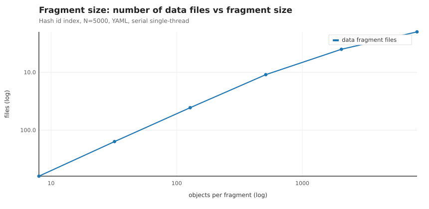
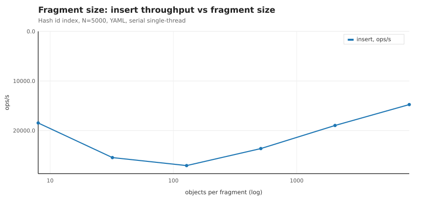
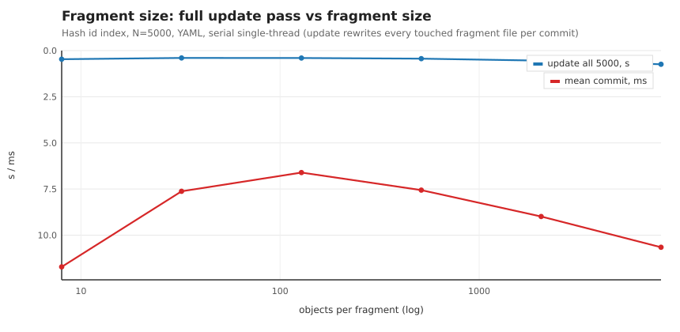
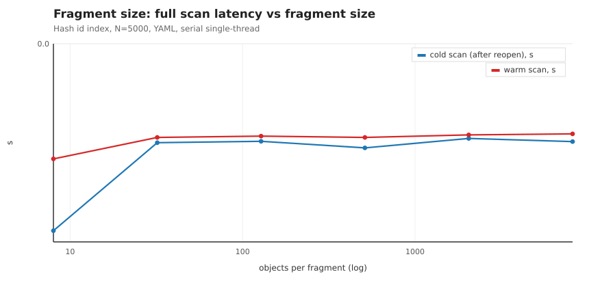
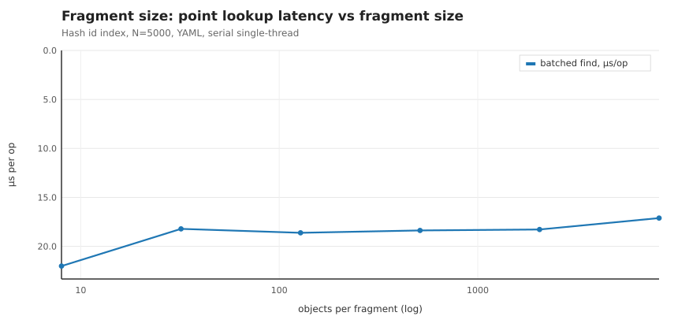

**Reading:**

1. **Both extremes lose.** Small fragments pay per-file costs: 626 files raise cold scan from 58 to
   110 ms and cost ~30% insert throughput (18.5k vs 27.1k ops/s; each commit touches several small
   files). One-fragment-per-class (8192) pays **whole-file rewrite per commit**: the update pass
   jumps to 742 ms (+85% vs 128) and insert drops to 14.8k ops/s.
2. **Sweet spot 128–512 objects/file** — ~55–225 KB fragment files for this entity size: minimum
   commit latency (6.6 ms), best insert (27.1k ops/s), flat scans, stable deletes. As a rule of thumb
   for other entity sizes: **aim fragment files in the tens-to-low-hundreds of KB; treat >1 MB
   fragment files as a red flag** (every writer commit rewrites the file).
3. **Point-lookup latency barely reacts** (17–22 µs/op warm, ~50–70 µs/op cold): `get(id)` resolves
   through the in-memory hash index to one fragment; only the file-count overhead at frag=8 shows
   (+20% warm, +20–35% cold).

### 5.3 Additional finding: read-only transaction cost scales with resource size

A begin → `load(id)` → commit cycle costs **~25 ms with the Hash index at N=5000 vs ~2.8 ms with the
BTree index** (verified in isolation, `SweepFindTxVerify`, **zero `resourceWriteOuts` in both**).
The Hash number also explains the frag-sweep column collapse at frag=2048/8192 (30/20 ops/s): it is
**commit-protocol CPU that scales with the resource cache size, not disk IO**. Consequences:

* High-rate single-read transactions (request-scoped `beginTransaction` per lookup) will hit a
  ~40 ops/s ceiling per storage at N≈5000 with the Hash index regardless of fragment size.
* Candidate fixes for the optimization backlog: cheaper no-change commit path (skip 2PC record
  iteration for read-only transactions), or the W-1 journal infra for cheaper commit bookkeeping.
  This is the **top optimization candidate** for read-heavy workloads.

## 6. B+Tree re-open blocker resolved and verified (R-53)

**Original defect (first edition of this study, 2026-10-19):** after `shutdown()` → re-open, every
by-id load, `has()`, search-EQUALS and even full scans through B+Tree-backed structures returned
empty, while the data and index files on disk were complete and correct. Affected:
`@XdStorageObjectIdIndexType(BTree)` id indexes **and all `@XdStorageObjectSearchIndex` search
indexes** (they are B+Trees internally). The default Hash id index was never affected. Verified
**pre-existing at clean HEAD `3674ed9`** via a `git worktree` checkout (not a W-1 regression).

**Root cause:** on a cold open, a persisted tree came back with parser-created stub nodes in
`root`/`firstLeaf`/`children` references — `XdStorageYamlBlockObjectsReader.readReference`
materialized references via `Class.newInstance()` with only the id set
(`serialization/yaml/XdStorageYamlBlockObjectsReader.java:146-190`), and
`XdStorageObjectUtils.isReference` (wrapper-interface check only,
`utils/XdStorageObjectUtils.java:53-54`) did not recognize them — so the R-38 stub-loading gates in
`XdStorageBTree.find()` (`btree/XdStorageBTree.java:467-480`) never fired, the descent ran over an
empty node, and every lookup missed (CHAIN_DEBUG: `root=1 rootKeys=[]` with the 5 keys sitting intact
in `XdStorageBTreeNode-1.yaml`).

**RESOLVED (R-53, 2026-10-19) — fix implemented in direction (b), plus two satellite defects the
regression test flushed out.** Committed in `cf36f7f`. Regression coverage:
`XdStorageW2ReopenBTreeTest` (reliability family; BTree id index t=8 multi-level + search index ×
shutdown → re-open → read/write).

1. **Stub recognition** — `XdStorageBTreeNode` got a persisted reference marker
   (`reference`, default `true`; real nodes `false` in the constructor; round-trips through the
   generic writer/reader as property `reference` — the getter/setter pair is deliberately named
   `isReference()`/`setReference()` so the property scanner binds it to the field). New marker
   interface `org.flib.xdstorage.code.IXdStorageReferenceMarked`; `XdStorageObjectUtils.isReference`
   now recognizes it, so every existing R-38 gate (root/children/next, 20 sites in
   tree/node/invariants) fires for parser stubs. Note: the tree's own legacy `isReference` field is
   NOT persisted (its getter derives property name `reference`, which has no backing field — the
   scanner silently drops it); the node's naming avoids that trap.
2. **Materialization is by-id canonical replacement, not generic fill**
   (`XdStorageBTreeNode.materialize`): `storage.load(XdStorageBTreeNode.class, id, tx)` returns the
   canonical instance (ФАЗА 3B identity); callers replace the stub in its slot
   (tree.root/firstLeaf, children list element, next pointer) and repair back-references
   (`setTree(liveTree)`/`setParent(liveParent)`). The generic `fillAndWrap` fill was unusable here:
   it materialized the node's `tree` back-reference as a bare lazy wrapper whose inner is an empty
   `newInstance` — `getTree().getT()` would be 0 and every post-reopen split/join threshold would
   corrupt.
3. **Canonical-registry poisoning by `references.yaml`** (found by the write-after-reopen test):
   the references-resource of an infrastructure class parses id-only stubs and `fillCache` adopted
   them into the global canonical registry; it prepares before the per-id object files, so the
   stub won `adoptOrRegister` and every later real parse was discarded (`LOST-TO-EXISTING`) —
   by-id loads then served empty "canonicals". `adoptCanonicalInstance` now refuses to adopt
   parser stubs (recognizable via the R-53 marker); the registry keeps only full/live instances.

**Verification performed for this re-run** (before sweeping):

```
java -cp <test classpath> org.flib.xdstorage.performance.sweep.SweepReopenRepro
[btree]  load id-0..4 -> ok ×5          (NULLS=0 of 5)
[hash]   load id-0..4 -> ok ×5          (NULLS=0 of 5)
[search] load by id -> ok; EQUALS Ship-3 -> 1 result(s); full scan -> 5 result(s)   (BAD=0)
```

**Consequences for this edition:** the cold/re-open and post-re-open delete phases excluded from the
first edition are now first-class measurements ([§4](#4-results-btree-fill-factor-t-id-index),
[§5](#5-results-fragment-size-hash-id-index), [§7](#7-results-search-index-t--hash-vs-btree-id-index)),
and the id-index recommendation becomes a genuine workload trade-off
([§7.1](#71-id-index-choice-hash-vs-btree-same-entity-frag512-n5000)). Old on-disk node files
(without the persisted `reference` marker) are self-healing per the fix description above.

## 7. Results: search index `t` (+ Hash vs BTree id index)

Search graph: 2 500 ships, each with a captain + 2-member crew (`StoreWithParentObject` children),
id index fixed BTree t=64, search-tree `t` swept. Full data: [`docs/perf/search.json`](perf/search.json).

| search t | tree files | tree KB (index) | indexed save (ops/s) | EQUALS (µs/op) | EQUALS + child (µs/op) | full scan (ms) | cold first search (ms) | cold search (µs/op) |
|---:|---:|---:|---:|---:|---:|---:|---:|---:|
| 8 | 833 | 8 929 | 6 370 | **20.6** | 53.9 | 53.4 | 19.5 | 163 |
| **64** | **133** | **7 486** | **8 910** | 20.4 | 52.4 | **53.2** | **15.6** | **134** |
| 500 (default) | 57 | 7 359 | 1 769 | 26.3 | 56.9 | 52.5 | 34.4 | 152 |

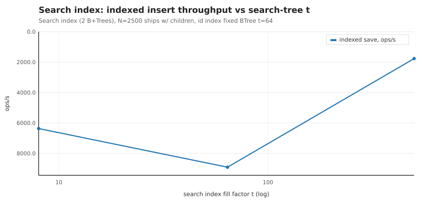
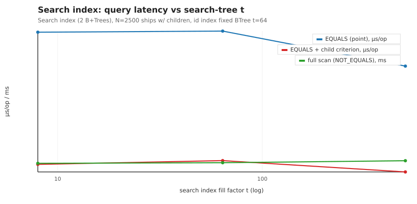
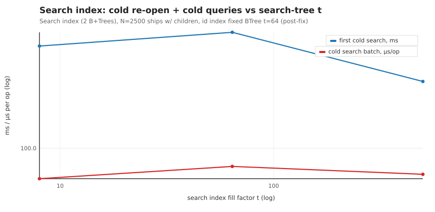

**Reading:** indexed insert peaks at t=64 (5× over t=500 — same node-rewrite law as §4, applied to
both trees per index: the main value tree and the `key_` tree). Query latency is t-insensitive warm;
**cold searches run 6–8× slower than warm** (134–163 µs/op — id-index descent + key-tree descent +
record fetch, all from disk), and t=500 pays an extra 34 ms on the very first query (big node parse).
A secondary field criterion or a child criterion adds ~0% on top of the EQUALS lookup (they are
evaluated on the already-fetched index record — this matches `docs/BENCHMARKS.md`). Non-EQUALS
primary criteria and queries without a primary fall back to **full leaf-chain scans** — ~53 ms per
query at N=2500, i.e. O(dataset): ~3.5–4× slower than the point path even at this small N, and the
gap grows linearly with the data.

**Recommendations (search):**
1. **`t = 64`** for `@XdStorageObjectSearchIndex(t=…)`; same "never below 8" rule as the id index.
2. **Always provide a primary `EQUALS` criterion** when the query shape allows it; treat
   scan-path queries (NOT_EQUALS / no primary / CONTAINS on the primary) as reporting-tier operations.
3. Child indexes are cheap to maintain relative to their benefit only when queried via EQUALS-first
   shapes; index child fields you actually filter on (each indexed child collection adds per-save
   tree maintenance).

### 7.1 Id index choice: Hash vs B+Tree (same entity, frag=512, N=5000)

| Metric | Hash | B+Tree t=64 |
|---|---:|---:|
| Bulk insert | 23.6k ops/s | **49.6k ops/s** |
| Warm batched find | 18.4 µs/op | **12.4 µs/op** |
| Read with per-op tx | 40 ops/s (25 ms/op) | **591 ops/s (2.8 ms/op)** |
| **Cold find after restart** | **52 µs/op** | 87 µs/op |
| Files at N=5000 | **12** (11 data + index) | 101 (83 tree + 18 data) |
| Delete-all | 214 ms | 183 ms |
| Range/ordered traversal | not supported (equality only) | **native** (leaf-chain order) |

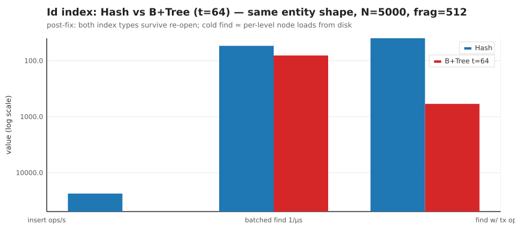

Both are restart-safe now (R-53) — the choice is a genuine workload trade-off:

* **Pick Hash** when cold-read latency after restart matters most (one fragment load vs a tree
  descent: 52 vs 87 µs/op), when the entity count per class is modest, or when operational
  simplicity (a dozen files per class vs a hundred) and the equality-only contract are acceptable.
  Its known weak spot: the ~25 ms read-transaction overhead at N≈5000 (§5.3).
* **Pick B+Tree t=64** for insert-heavy pipelines (2.1× throughput), high-rate per-op-read
  services (14× less commit-protocol overhead), and anything that needs ordered traversal of keys.
* Either way: **t = 32…128 if B+Tree**, fragment 128–512 for both, and re-measure at production
  volume before locking the choice.

## 8. Storage-level configuration recommendations

All knobs live in `XdStorageConfig.builder()` (defaults reproduce pre-config behavior):

1. **`durableWrites`** — keep **off** for dev/batch throughput, **on** whenever the machine can lose
   power (each commit gains an fsync of the resource file + parent dir; measured cost is one
   fsync per written file — significant with small fragments/many files at low `t`, modest at
   frag 128–512). Process-crash safety is unconditional (atomic rename); this knob is about
   power-loss.
2. **`journalWrites` / `journalCheckpointBytes`** (W-1, YAML-only) — off by default. The §5 data
   explains when the journal pays: workloads with **frequent small commits to large resources**
   (big fragments, wide classes) spend their time rewriting whole fragment files; the append-only
   journal converts those into sequential appends. Enable for commit-bound write-heavy storage with
   fragment files ≥ ~1 MB; keep the 16 MB checkpoint default.
3. **`defaultTransactionTimeoutMillis`** — the 3 s default is tight for batch writes: a single
   500-object commit at t=2 measured ~129 ms warm, delete-all passes run seconds at low `t`, and
   cold caches with bigger graphs will exceed 3 s (the engine's own BTree loader warns about exactly
   this). **Pass explicit timeouts for batch work** (harness uses 120 s); consider raising the
   default to 10–30 s for batch-oriented services.
4. **`workerPoolSize`** — 15 (default) is fine for this 24-core box; there was no worker-pool
   pressure in any serial phase. Scale with concurrent writer count, not with cores.
5. **`isolationLevel`** — `SNAPSHOT` (default) for correctness-sensitive reads; `READ_COMMITTED`
   only where the slightly cheaper visibility checks matter. Index caches are engine-pinned to
   READ_COMMITTED regardless.
6. **Entity layout** — `StoreAsClassObjects` (fragmented) for all "many small objects of a class"
   domains, with §5's fragment sizing; `StoreAsSingleObject` only for genuinely large/top-level
   graphs (that is how the engine stores B+Tree infrastructure itself — and §4 shows what one-file-
   per-object does to file counts at small sizes).

## 9. How to re-run

```bash
mvn test-compile
mvn -q dependency:build-classpath -Dmdep.outputFile=target/sweep-cp.txt -Dmdep.includeScope=test
CP="target/test-classes:target/classes:$(cat target/sweep-cp.txt)"
# full sweep (~4 min on a quiet 24-core box):
java -Xmx6g -Dlog4j2.configurationFile=file:$PWD/target/sweep-log4j2.xml \
     -cp "$CP" org.flib.xdstorage.performance.sweep.XdStorageConfigSweep all 5000
# suites individually: tsweep | fragsweep | search ; smoke first: smoke 300
# re-open sanity (must print NULLS=0 / BAD=0):
java -cp "$CP" org.flib.xdstorage.performance.sweep.SweepReopenRepro
# charts + tables from target/sweep/*.json:
python3 scripts/render-sweep-charts.py
```

`target/sweep-log4j2.xml` (WARN console + file sink) is used instead of the test classpath's TRACE
config — **the existing JMH numbers in `docs/BENCHMARKS.md` were measured with TRACE console
logging enabled**; expect somewhat better absolute numbers from a quiet-config re-measure.

## 10. Monitoring

`storage.getMetrics()` (per storage) and `XdStorageMetrics.engineEvents()` (JVM-wide) are the
alerting surface:

| Counter | Healthy | Alert when |
|---|---|---|
| `resourceWriteOutNanos / resourceWriteOuts` | 0.1–6 ms/file, scales with fragment size | sustained growth ⇒ fragments too big or disk saturating |
| `transactionsBegun − transactionsCommitted` (delta over window) | ≈ rolledBack | sustained positive ⇒ timeouts/rollbacks in prod |
| `timeoutSweptRollbacks`, `rollbackOnlyMarks` | 0 | > 0 ⇒ tx timeouts too tight (see §8.3) |
| `lockAcquisitionTimeouts`, `lockWaitsOver1s`, `findRetryBudgetExhaustions` (engineEvents) | 0 under serial load | any ⇒ sustained write contention — revisit thread counts / batching |

## 11. Appendix: archived artifacts

* Raw results: [`perf/tsweep.json`](perf/tsweep.json) · [`perf/fragsweep.json`](perf/fragsweep.json) ·
  [`perf/search.json`](perf/search.json) (+ `.csv` twins) · [`perf/full-run-console.log`](perf/full-run-console.log)
* Harness & entities: `src/main/test/org/flib/xdstorage/performance/sweep/` —
  `XdStorageConfigSweep`, `SweepReopenRepro` (re-open sanity — must stay green), `SweepFindTxVerify`
  (read-tx write-out check), `SweepHashEntity`, `SweepBTreeT{2,4,8,16,32,64,128,500}Entity`,
  `SweepSearchShipT{8,64,500}`, `SweepSearchCrewMember`
* Charts: `scripts/render-sweep-charts.py` → `docs/perf/*.svg`
